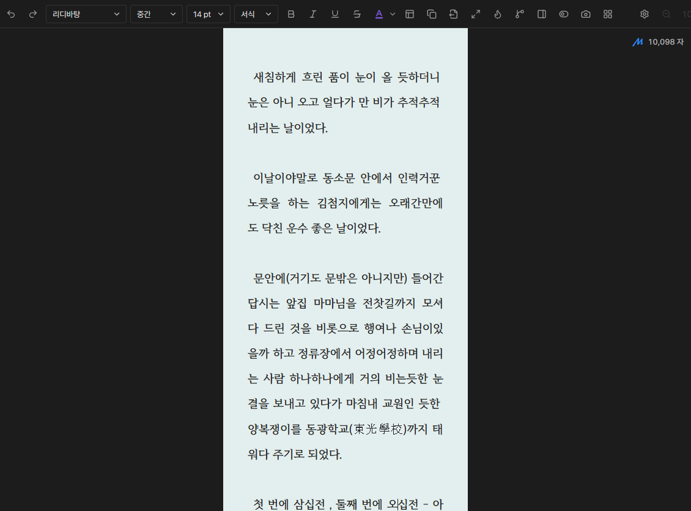
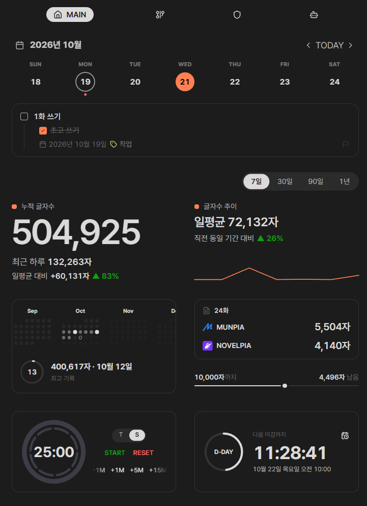

# Writing Menu

**English** | [한국어](README.ko.md)

A writing workspace for fiction and serial stories in Obsidian. Draft manuscripts, plan plots and characters, review your writing, and ask questions about your project.

**Version 3.4.1** · [Download](https://github.com/zpzp13/obsidian-writing-menu/releases/tag/3.4.1)

## Write your manuscript

- Use a shared writing toolbar in Markdown and the desktop-only paged view.
- Adjust fonts, spacing, paragraphs, and text color. Work with focus mode, typewriter scrolling, smart quotes, and text replacements.
- Check character counts, copy your text, and export to TXT or HWP. HWP conversion requires Windows and Python.

Markdown writing view

## Plan your story

Organize plots, characters, foreshadowing, and checklists in project workbooks.

- Manage sheets, rows, columns, subrows, statuses, labels, and cell formatting.
- View and edit the selected row or column as cards in the sidebar.
- Search, paste multiple cells, undo changes, and export to Markdown.

## Deus AI

Ask questions using your project's manuscripts, character notes, and plots.

- **Research:** Look up relationships, chapter events, and character histories. Follow citations back to the source.
- **References:** Add notes with `@` and manage included material from the `+` menu.
- **Character dialogue:** Use `/character` to try a conversation for the current scene or a situation you describe.
- **Conversations:** Search, pin, branch, and export project sessions.

<table>
  <tr><th>Answers with sources</th><th>Character dialogue</th></tr>
  <tr>
    <td width="50%"></td>
    <td width="50%"></td>
  </tr>
</table>

Requires a Gemini API key. Citations open in the current tab by default; you can choose a new tab in settings.

## Review and restore

- Analyze sentence and paragraph lengths, dialogue proportions, and repeated expressions in a manuscript or an entire project.
- Compare manuscript snapshots and restore the full text or selected changes.
- Transfer plot workbooks between devices with Markdown snapshots and restore them manually.

## Character wiki

Keep character profiles, images, and properties together, and explore connections in a relationship graph.

<table>
  <tr><th>Character profile</th><th>Relationship graph</th></tr>
  <tr>
    <td width="50%"></td>
    <td width="50%"></td>
  </tr>
</table>

## Writing dashboard

Track tasks, schedules, character counts, writing time, goals, and timers. Includes character counting for Munpia and Novelpia, plus playback of audio stored in your vault.

## Mobile tools

Look up Korean words, review spelling corrections, and insert symbols with layouts that fit the screen and keyboard. Choose mobile fonts separately from desktop; downloaded fonts remain available offline.

<table>
  <tr><th>Dictionary and Hanja</th><th>Spell checking</th><th>Special characters</th></tr>
  <tr>
    <td width="33%"></td>
    <td width="33%"></td>
    <td width="33%"></td>
  </tr>
</table>

## Install and get started

1. Download `writing-menu-3.4.1.zip` from the [release page](https://github.com/zpzp13/obsidian-writing-menu/releases/tag/3.4.1).
2. Extract the ZIP and copy the complete `writing-menu` folder into `.obsidian/plugins/` in your vault.
3. Enable Writing Menu in Obsidian's Community Plugins settings. Keep your existing `data.json` when updating.
4. Register your project and manuscript/character folders in the plugin settings. Add API keys for the dictionary and Deus AI services you use.

Assign shortcuts under **Obsidian Settings → Hotkeys → Writing Menu**.

## External services and license

Deus AI sends your conversation and reference material to the Gemini API. Dictionary and spell-checking tools use their respective services. Mobile fonts and optional analysis assets are downloaded on request and stored locally. Spell checking uses unofficial endpoints; follow the provider's terms.

See [plugin permissions](docs/plugin-permissions.md) for filesystem, Python, clipboard, and local-storage usage.

[MIT License](LICENSE). Notices for external components, including Claudian, are included with the relevant code and distribution files.
